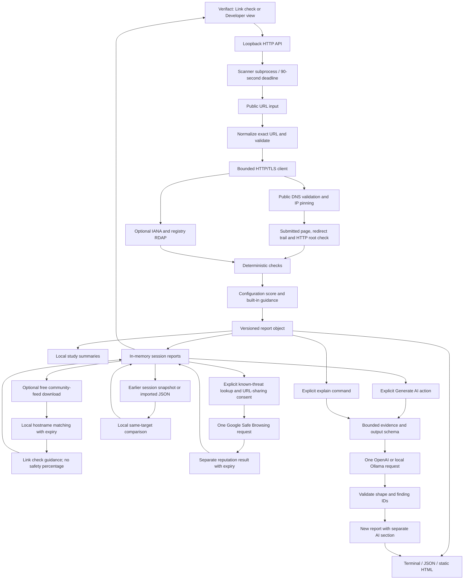

# Verifact architecture

Verifact 0.6 has two views over one evidence model: **Link check** guidance and a **Developer** configuration review. The implementation lives in the `verifact` Python package. `python -m verifact` and the installed `verifact` command call the same CLI. Existing schema-version-1 reports remain readable.

The scanner transport owns destination policy. Every website or RDAP request goes through the same validation and socket connection path, including redirects and registry lookups. A validated DNS answer is used directly for the socket; the hostname stays in the HTTP Host header and TLS SNI/certificate check. No automatic redirect or proxy handling can bypass this path.

The scanner collects results. Checks consume response objects and make no requests. `assessment.py` derives the developer configuration score and built-in guidance from those findings without AI or network requests. `dashboard.py` selects configuration summaries and owner priorities. `visitor_assessment.py` derives a separate visitor label from connection, destination and current threat evidence; it never uses a checklist percentage as a probability of safety. Reports consume findings, escape untrusted evidence, and contain no remote assets. The offline demo builds synthetic response objects and exercises the same checks and reports.

`links.py` canonicalizes the supplied public HTTP(S) URL, preserving its path and accepted query while omitting its fragment. A bare domain defaults to its HTTPS root. `scanner.py` checks that exact destination and separately requests the target hostname's HTTP root to observe its HTTPS upgrade. It does not replace an HTTP link with a different HTTPS page: an unencrypted final response receives a transport attention finding, and an HSTS header sent over HTTP does not earn credit. Page and TLS findings describe the supplied link's final response; the HTTP-upgrade finding names its separate root scope.

The optional expected domain is an explicit user input, never guessed from a brand name. Matching requires an exact hostname or a dot-delimited subdomain. URL observations record the ordered redirect trail, hostname transitions, final destination, international-domain spelling, mixed-script cues and a small explained similarity heuristic. An incomplete trail does not invent a final destination or expected-domain match. These observations are not an impersonation classifier or ownership proof.

Common credential-like query keys and one-time action paths are blocked before requests, including redirect requests. This policy is conservative and incomplete: it cannot recognize every confidential or state-changing URL. Accepted full URL paths and queries remain in reports, so users must review exports before sharing them. No cookies are replayed, forms submitted or JavaScript executed.

`schema_version` distinguishes report formats; `tool_version` identifies implementation changes. Findings have stable `id`, `category`, `status`, `title`, `evidence`, `explanation`, and `recommendation` fields. Evidence remains separate from interpretation. Certificate timestamps use the scan's UTC clock; do not compare changing demo timestamps as factual observations.

## Configuration score and free explanation

The score belongs to Developer mode. Link check mode does not show an overall percentage safe. Missing owner hardening controls are not automatically evidence that a visitor is at risk of phishing. Both modes show their limited scope, evidence gaps and measured timestamps. Switching views only changes presentation and never adds a request.

`report.assessment` records a custom weighted configuration checklist, not a security probability or a standardized rating. Its fixed maximum is 100 points: TLS verification 25, HTTP-to-HTTPS upgrade 15, certificate renewal window 5, HSTS 15, nosniff 10, CSP presence 10, framing policy presence 10 and absence of explicit HTTP resource references in inspected markup 10. CSP and framing findings can remain informational while receiving presence credit; their effectiveness is not established. Domain metadata and non-security page-quality findings do not affect this score.

The assessment records earned points, the potential total including unassessed points, weighted coverage, assessed-check counts, per-check contributions, a method version and interpretation notes. Unknown or missing checks retain their weights in the denominator. Partial observations are displayed as an earned-to-potential range, not a falsely precise normalized result. With no assessed checks, the score is unavailable. Coverage measures only the weighted checklist assessed, not security coverage of the whole application.

`report.guidance` is labeled `kind: "rules"`. It selects existing explanations and suggested next steps from useful findings, prioritizing review and unknown results, and cites their stable IDs. This is a deterministic built-in explanation, not generated model prose. The renderer recalculates assessment and guidance from findings when opening saved reports, so old reports gain the feature and an arbitrary stored score is not accepted as authoritative. AI output remains separate and cannot revise the score or measured findings.

`report.dashboard` is also recalculated from findings. It contains an overall `rating`, three `signals`, up to three `priorities` and security-only counts. Signals group connection, browser protection and page exposure observations. Priorities cite stable finding IDs and exclude non-security quality or domain-age observations. Color is paired with a label, and incomplete evidence remains visible as unknown rather than as a failure or a green result.

Traffic lights are a separate, documented product heuristic: complete checklist evidence starts green at 80–100 points, amber at 50–79 and red below 50. Any observed security attention finding prevents green. Certificate-verification attention or observed HTTP/GET password submission makes the label red, including when the score is high or evidence is partial. Otherwise incomplete evidence has a neutral label. Password-form and cookie observations can affect the review label but remain outside `configuration-v1`'s numeric weights. This distinction keeps the score reproducible while avoiding a reassuring green next to an unscored issue.

`report.site_profile` records a bounded page title, meta description, inferred type, plain-language `summary`, supporting `signals`, `basis` and `profile_version`, plus returned hostname, HTTPS flag and HTTP status. `profile.py` combines bounded static page wording, learning-platform and account-form cues with appropriate domain context. A password field alone does not prove a university login page; registration and recovery pages need distinct descriptions. Page wording remains website-controlled, and classification never verifies organizational identity. Old reports can be described from their existing title, response and form observations, without fetching new content. Profile data does not affect the security score or trigger AI.

The response object keeps separate `Set-Cookie` fields in memory because combining them with commas loses boundaries when an `Expires` attribute contains commas. Cookie findings serialize only names and selected attribute facts, never values. Missing `Secure` deserves review; missing `HttpOnly` or `SameSite` by itself is informational because the purpose of the cookie is unknown. Password-form observations resolve static actions against the response URL and document base, account for form submission overrides, and distinguish HTTP/GET concerns from cross-origin review. Neither check sends a form, enters credentials, executes scripts or makes additional network requests. Truncation or unsupported markup prevents a positive conclusion.

## Deliberate limits

No database, hosted API service, user accounts or custom trained model. The web app retains reports in memory; downloaded JSON files provide durable storage. The CLI also reads and writes report files. The optional AI feature integrates existing models and does not train a classifier or determine whether a site is secure.

The transport bounds body reads and socket waits but is not a complete resource-isolation layer: system DNS resolution and slow HTTP headers can take longer than the requested budget. Standalone CLI requests are sequential. The web app launches each scan as a subprocess with a 7-second per-request budget and a 90-second overall timeout. This bounds a scan even if DNS or headers stall. Public hosting would still need network-level egress restrictions and stronger isolation.

The HTML parser observes raw markup without executing scripts or fetching resources. CSP policies are recorded without claiming strength; metadata cannot establish site legitimacy. A valid certificate establishes a verified connection to a name, not trustworthiness of the organization.

## Local web interface

`server.py` uses Python's standard-library HTTP server and serves the buildless HTML/CSS/JavaScript interface from `verifact/static/`. The `serve` command binds exclusively to `127.0.0.1`, normally on port 8765. The web app is intended for trusted use on the same computer, not as an Internet-facing service.

The browser accepts a public domain or HTTP(S) URL. Input parsing rejects credentials, custom ports, invalid hostnames and recognized private-token links. The full canonical URL travels to the scanner through standard input, avoiding the process command line; expected-domain input is separately normalized. Network requests retain the existing public-IP checks and per-redirect validation. The child scan process is invoked without a shell and does not inherit `OPENAI_API_KEY` or `GOOGLE_SAFE_BROWSING_API_KEY`.

The API checks Host and Origin headers, rejects cross-site fetches, and requires a random session token on JSON POST requests. Static responses use restrictive browser headers. There is no generic file-serving route, arbitrary URL proxy or public bind option. These controls reduce local attack surface but do not make the server suitable for untrusted public access.

Session state holds at most 20 jobs, with one scan, one AI generation and one reputation lookup allowed at a time. Workers update job status while the browser polls. The oldest completed job can be evicted when a new job exceeds the limit; active jobs are retained. Reports are downloaded as JSON or standalone HTML. Stopping the server clears history and any key entered through settings.

The interface starts with a Link check/Developer mode choice and one link input. Link check mode prioritizes practical link guidance and coverage; Developer mode exposes configuration results and owner actions. `brief.py` derives ten core security observation states and short authored reviews from recorded evidence on each server read; it does not trust a cached brief or modify scoring. Eight observations have numeric weights. Additional link, page-dependency, referrer and configuration-hygiene reviews remain outside those weights. Expired provider matches are removed from visitor interpretation and review counts. Details and comparisons remain available without being required to understand the first result.

The standalone HTML export uses a restrained midnight-blue theme, 16px body text, larger headings and visible boundaries. It embeds fonts and their licenses, escapes site/model text, and makes no external requests. Link check observations and developer checklist points are labeled separately. External-list data is historical provenance, not a live verdict in an offline file. JSON preserves the recorded evidence and derived views for analysis. Copying a summary does not publish a report.

`page_risks.py` observes bounded script and iframe source declarations in the already-fetched HTML. It resolves supported sources against the document base, records only origins, and never fetches or runs dependencies. Cross-origin scripts without syntactically usable integrity metadata produce an owner review, not a malware verdict. Metadata is not verified against script bytes. Unsupported markup, unresolved URLs and incomplete bodies prevent a complete inventory. Older reports do not invent missing observations. Referrer declarations receive a separate unscored review for explicit `unsafe-url`; missing policies remain neutral, and effective browser behavior is not asserted.

`security_hygiene.py` adds six unscored findings from the same response: `header_quality`, `cors_policy`, `response_caching`, `browser_isolation`, `public_disclosures` and `iframe_sandbox`. It uses bounded declaration facts rather than copying arbitrary header arguments or page text. Multiple CSP policies are distinguished from repeated directives within one policy. CORS inspection sends no modified Origin or preflight, does not test credentials, and never labels a wildcard alone as a leak. Cache review flags explicit shared caching with account/cookie context for an owner to inspect, without asserting personalized content. Isolation policies are optional observations. Software banners are hints, never verified CVE/version matches; debug markers are considered only on server-error responses. Iframe review considers supported static initial-source and sandbox-token combinations, without running embedded content. The six findings do not alter the eight score weights or ten core observation counts.

`brief.py` includes attention findings from these six checks as separate `source: "hygiene"` owner reviews. It constructs short why/action text from recognized evidence, ignores informational/unknown/duplicate records and never trusts imported review prose. Their amber reviews appear in `all_reviews` and can fill the top three priorities, while core counts and weighted scoring stay unchanged. They do not influence Link check interpretation. Saved reports include a separate unscored developer-review section.

The optional `security_contact.py` check retrieves the standard public disclosure-contact file when `security_contact: true` is requested in the app or `scan --security-contact` is selected in the CLI. It is off by default and uses the guarded transport and existing scan budget. A community-list preflight block prevents this visit too. It reviews supported declarations and expiry without sending messages or following contact links. Missing contact information is not a vulnerability or score deduction; publication grants no testing authorization. See [RFC 9116](https://www.rfc-editor.org/rfc/rfc9116.html).

The settings endpoint stores the selected provider and any entered OpenAI key only in server memory and returns configuration status, never the key. Built-in explanations are the initial mode, including when an environment key exists. An environment key is used when no session key exists; the UI recognizes it without prompting for a duplicate. Configuration status means a key is present; no authentication or balance request is made when saving it. Keys are not written to browser storage, report files or request logs. A running AI worker retains its copied key until the request finishes, even if the settings key is cleared. Clearing a session key does not remove an inherited environment key. `.env` files are not loaded automatically.

An explicit AI explanation action operates on a completed report using the selected OpenAI or local Ollama provider. Built-in mode needs no generation request. The endpoint reuses running/completed AI results for that job to avoid duplicate calls from repeated clicks. Configuration exposes `ai_prompt_version`; a boolean `refresh: true` on the explanation request permits replacing a stored, non-fixture answer only when its prompt version differs. Current answers and running updates stay cached even if this flag is repeated. The original answer remains available until the new request succeeds. Failed generation preserves the measured report and built-in guidance; retrying is a new explicit action and OpenAI retries can incur usage. The synthetic demo already has hand-authored example explanations and cannot trigger a paid AI generation.

## Reputation boundary

### Free community domain feed

`threat_feed.py` retrieves a fixed CERT Polska domain feed and compares target/redirect hostnames locally. Target URLs, paths and queries are not submitted to the feed provider. The browser app uses a bounded in-process cache rather than downloading a separate copy for every scanner subprocess. The feature is enabled by default for web checks and can be disabled; CLI callers opt in with `scan --community`.

Feed retrieval runs in a short-lived subprocess with a 12-second wall-time limit, including DNS and headers. Timeout kills and reaps that process, records unavailable/backoff and lets the website scan continue. The child receives no OpenAI or Google key, and its fixed-source response body is bounded to 16 MiB. A single refresh runs at a time outside the cache lock, so existing reports remain readable during a slow refresh. Current matching community warnings also enter the Developer review list as red, expiring `source: "community"` items; stale, removed or unrelated matches do not. This changes review totals, not core counts or configuration points.

A fresh listed input hostname can stop the website visit before its page is requested. Redirect hosts are matched after they become observed evidence. The feed has bounded download/parsing resources, explicit freshness and distinct `listed`, `no_match`, `unavailable` and `not_checked` states. A download or parsing failure cannot become `no_match`. Matching a listed parent domain is explained as a subdomain match, without claiming independently observed malicious content. A feed non-match does not verify ownership or guarantee safety.

`report.community_reputation` records source, checked hostnames, check/fetch/expiry times, match scope and coverage. `report.visitor_assessment` contains a status (`warning`, `caution`, `no_warning` or `unknown`), authored reasons, next action and separate coverage facts. The server recomputes this interpretation when returning a report so an expired external result cannot stay a current warning or clearance. Older files without these fields remain usable and do not invent a community lookup. Saved reports never refresh a feed or make external requests while rendering.

### Optional Google lookup

`reputation.py` makes an optional Google Safe Browsing v4 `threatMatches.find` request. Its network destination is fixed to `safebrowsing.googleapis.com`; there is no arbitrary proxy endpoint, redirect following or automatic retry. The API key is sent in the `X-Goog-Api-Key` header and a bounded list of URLs in the JSON body. URL/key validation, an at-most-12-URL input, a 128 KiB response limit and provider response checks bound the integration. Malformed responses, provider failures and unrecognized response shapes become unavailable instead of a no-match verdict.

The server reads a session key or `GOOGLE_SAFE_BROWSING_API_KEY`. Saving a key or selecting settings makes no provider call. A completed real report and explicit consent are required: the UI previews the submitted and observed redirect URLs, including paths and queries, before sending them. Imported comparison files are never added to this list. The request sends no page body, cookie values, AI text or unrelated reports.

`report.reputation` is independent of `report.assessment`. It records provider, status (`listed`, `no_match`, `not_checked` or `unavailable`), checked URL count, observation time, matched URLs and validity metadata. Listed results mean potentially harmful according to the provider, with the required Google advisory attribution and notice that false positives and false negatives are possible. A no-match response does not establish safety and never raises the configuration percentage.

Each listed warning expires no later than the provider's returned `cacheDuration`; `public_result` removes expired warnings on server reads, and the browser removes a displayed warning when its validity ends. Still-valid positive matches are reused from a bounded in-memory cache, avoiding prohibited repeated queries for those URLs during their validity. It does not silently request fresh data. Downloaded HTML and text contain neutral historical lookup provenance rather than an active warning that cannot expire offline. JSON is a timestamped observation, not live protection. Provider data must be treated as historical when reused.

The integration is intended for Google's documented free non-commercial use, subject to quotas and [usage terms](https://developers.google.com/safe-browsing/v4/usage-limits). A commercial service needs an appropriate license/service, such as Web Risk. Each installer supplies their own key via the [Google setup workflow](https://developers.google.com/safe-browsing/v4/get-started); the repository contains no shared credentials or threat database.

## Snapshot comparison boundary

`comparison.py` compares selected security observations without network or AI. The automatic path selects a compatible earlier session report after a scan. Users may also upload a saved Verifact JSON report, bounded to 1 MiB and validated for the report schema; only the bounded comparison result is retained on the current report. Imported reports are user-supplied records, not independently verified measurements.

Targets must match by scheme, hostname, path and query; only equivalent default ports/hostname casing and fragments are normalized away. Legacy reports without `target_url` describe the HTTPS homepage. Demo and live reports cannot be mixed. Both timestamps must include time zones, and the selected previous timestamp must precede the current one; newer, equal or undated imports are rejected.

The comparison covers TLS/certificate fields, selected security headers, HTTP upgrade observations, password-form and cookie attributes, final response status/destination and redirect trail. It suppresses routine certificate countdown and per-response CSP nonce changes. Before/after summaries are bounded, remove control characters and mask URL query values; cookie values are never copied. A change is a neutral observation, not automatically improvement, deterioration or compromise. Source reports remain intact, and a comparison cannot alter measured findings or the numeric score.

## AI request boundary

The `explain` command reads a saved report and prepares selected fields as untrusted data. Evidence is bounded, URL queries/fragments are masked, and prior AI output is not treated as new measured evidence. Full response bodies, cookies and credentials are not prompt inputs. This is limited redaction, not comprehensive sensitive-data detection. `--preview` shows the messages and schema without making a network request.

The CLI selects the provider explicitly, with Ollama as its default. The web app defaults to built-in explanations and offers both AI providers as optional choices. OpenAI uses its Responses API with structured output and `store: false`, reading a key from session settings, `OPENAI_API_KEY` or the CLI's hidden prompt. Ollama receives a schema through its local chat endpoint at `127.0.0.1:11434/api/chat`. The user must install and open Ollama, then pull the local `qwen3.5:2b-q4_K_M` model once. This Qwen 3.5 2B model is approximately a 1.9 GB download plus Ollama itself, with additional memory needed at runtime. Local inference uses that person's hardware without an API fee; availability and speed depend on the computer rather than being promised for every laptop. The model gets no tools and cannot choose destinations. The local AI connection is separate from the public-site HTTP client's address policy; it does not create a scanner bypass for private addresses.

Each invocation makes at most one model request. There are no automatic retries, cloud fallbacks or model downloads. Output-token and request-time limits bound normal use; the web worker uses a 60-second request timeout for OpenAI and 120 seconds for local Ollama. Authentication failures, unavailable models, provider errors and invalid output are surfaced instead of being replaced with invented explanations. The original JSON report remains intact in the CLI workflow, and the measured report remains available in the web session.

Accepted model output is added under `report.ai`:

| Field | Purpose |
| --- | --- |
| `provider`, `model` | Generation source |
| `generated_at`, `prompt_version` | Reproducibility metadata |
| `usage` | Available input and output token counts |
| `summary` | A bounded overview connecting the selected findings to the available site context |
| `items` | Explanations with `finding_id`, `explanation`, `why_it_matters`, `next_step` and `limitation` |
| `unassessed_finding_ids` | Original checks whose result remains unknown |
| `validation` | Description of what the validator actually checked |
| `fixture` | Distinguishes hand-authored sample content |

New generated explanations contain a report overview and separate observation, practical significance, next-step and limitation fields. Validation checks this structure and references to known findings. It does not establish that a model's prose follows from the evidence. The renderer labels the AI section separately, preserves measured statuses, escapes generated text and links citations to evidence cards. Older saved items that lack the new narrative fields still render without inventing missing explanations. `render` converts enriched JSON to HTML or terminal output locally, with no new model call. The `demo --ai-sample` fixture is for presentation checks and is not an AI evaluation result.

## Distribution and operating costs

The intended public-repository workflow distributes code rather than the maintainer's credentials. Each person runs the scanner locally, gets deterministic explanations without a key, and optionally uses their own local model or OpenAI credit. Do not embed an API key in Python source or browser assets. Keeping `.env` ignored is helpful but does not prevent hardcoded secrets or remove prior commits. [OpenAI's authentication documentation](https://developers.openai.com/api/reference/overview) recommends server-side environment variables or a key management service.

A static project showcase can use [GitHub Pages](https://docs.github.com/en/pages/getting-started-with-github-pages/what-is-github-pages). It cannot execute this Python scanner. A live public checker would require a hosted backend, stronger egress isolation, abuse prevention and resource limits. Hosted AI still consumes someone’s compute or API balance; hiding a server key is necessary for secrecy, but does not prevent authorized visitors from generating costs. No public deployment is provided by the local `serve` command. See the [Ollama FAQ](https://docs.ollama.com/faq) for local runtime setup.
